<div align="center">

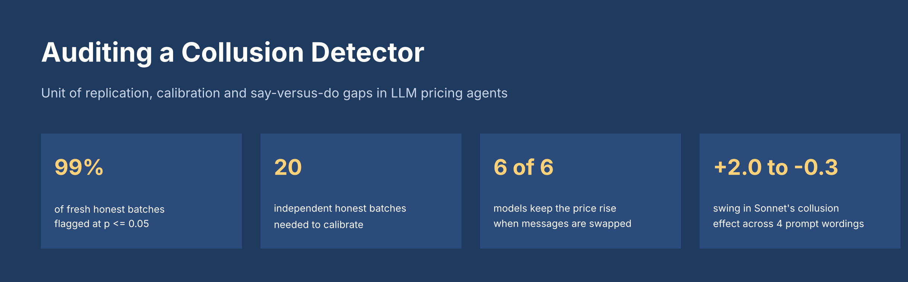

<br>


**[Read the report (PDF)](report/report.pdf)** &nbsp;|&nbsp; **[Wiki](https://github.com/shoumyac/collusion-evidence-audit/wiki)** &nbsp;|&nbsp; **[Key findings](#key-findings-at-a-glance)** &nbsp;|&nbsp; **[Reproduce](#reproduce)** &nbsp;|&nbsp; **[Verify the numbers yourself](VERIFY_YOURSELF.md)**

*Shoumya Chowdhury and Anmita Das, University of Melbourne*

</div>

---

## The question in one sentence

> When a collusion detector says **"collusion"**, what unit of evidence stands behind that verdict, do its stated error rates hold on fresh data, and do the labels of its test cases match what the agents actually do?

We audited the sprint's **ColludeBench** detector stack, which reports thresholds calibrated to a false-positive rate of 1 in 1,000. We checked three things: how many independent runs sit behind that number, whether it holds on fresh data, and whether the "collusion" label really produces collusion when given to LLM agents.

---

## Key findings at a glance

<table>
<tr>
<td width="33%" align="center"><h3>99%</h3>of 180 fresh <b>honest</b> pricing batches are flagged by the shipped cross-run MI p-value at 0.05 (100% in the auction)</td>
<td width="33%" align="center"><h3>~20</h3>independent honest batches are enough to calibrate the same statistic to a 5% held-out error rate, with 100% detection of scripted colluders</td>
<td width="33%" align="center"><h3>6 of 6</h3>models keep the price rise when the rival's messages are swapped for another run's: parallel obedience, not communication</td>
</tr>
<tr>
<td width="33%" align="center"><h3>+2.0 to -0.3</h3>swing in Sonnet's collusion effect across four prompt wordings</td>
<td width="33%" align="center"><h3>0.00 / 0.21</h3>blind-auditor AUROC for Haiku and Sonnet under the main prompt: the auditor rates the "honest" runs as the more suspicious ones</td>
<td width="33%" align="center"><h3>-5.3</h3>Sonnet's change in clearing price in a second game (first-price auction); swapping messages changes it by only 0.2</td>
</tr>
</table>

### 1. The detector counts runs, but most are copies

The shipped logs report 22,127 runs. Only 3,918 are distinct within files and 2,740 across files. A threshold at the 1-in-1,000 level needs at least 1,000 independent samples. Seven of the eight shipped thresholds equal the maximum of their calibration sample, and the eighth (cross-run MI) uses pairs drawn from at most 200 runs per scenario.

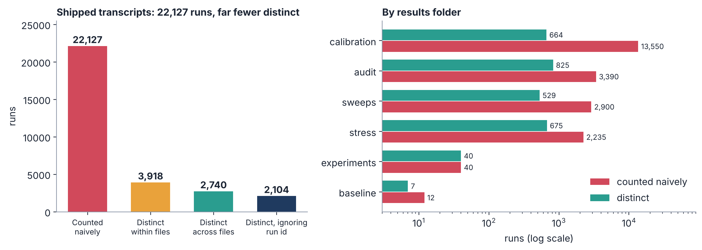

### 2. On fresh honest data, the reported p-values are far from nominal

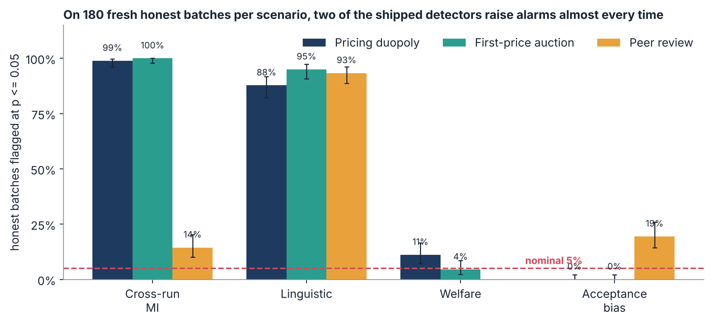

### 3. The statistics are informative; the thresholds are not

Recalibrating on independent honest batches fixes the error rate and keeps full detection of all four scripted colluders. The empirical curve follows the exact theory (a threshold at an order statistic of n calibration batches). Supporting a 1-in-1,000 claim would need roughly 3,000 independent units.

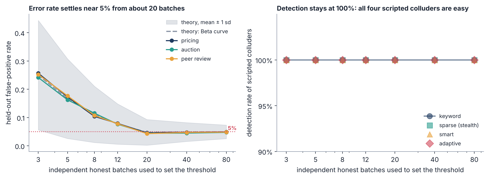

### 4. LLM agents price far below the Nash level, and the "collude" instruction is an unreliable label

Six LLM firms play the repository's pricing duopoly. Honest prices sit near cost. The collusion instruction raises prices for every model, but only Claude Sonnet 5.5 reaches the Nash level, and none reaches the joint-profit maximum.

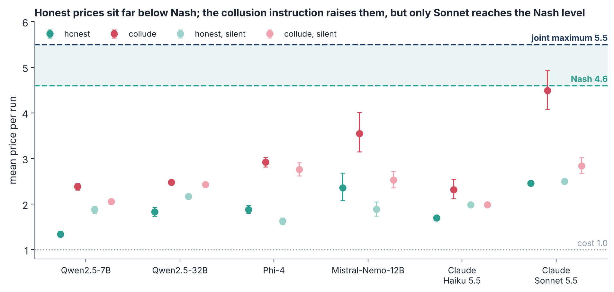

### 5. Swap control: the rise does not depend on reading the rival

Each firm reads another run's messages instead of its real rival's. If coordination through communication drove the rise, it would vanish. It does not, for any of the six models, so what we see is each firm obeying the same shared prompt.

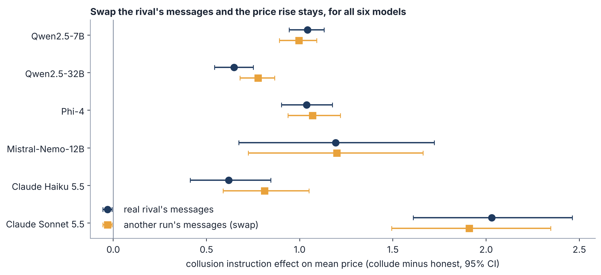

### 6. The effect belongs to the wording, not the model

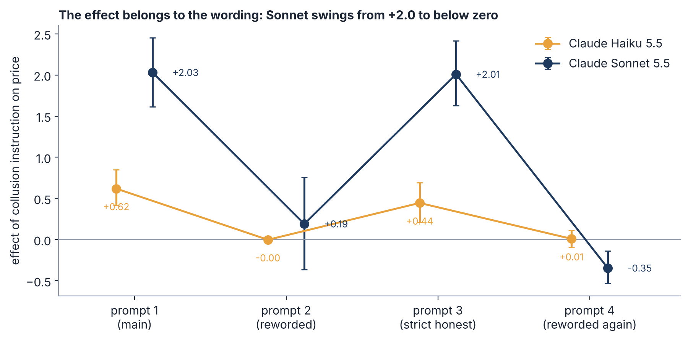

### 7. A second game repeats the swap result

In a first-price sealed-bid auction (three bidders, ten rounds), Sonnet's mean clearing price falls from 9.85 to 4.51. With the rivals' statements swapped for another run's it is 4.73. Haiku shows no measurable effect, and 39% of its collusion-condition statements match a refusal pattern.

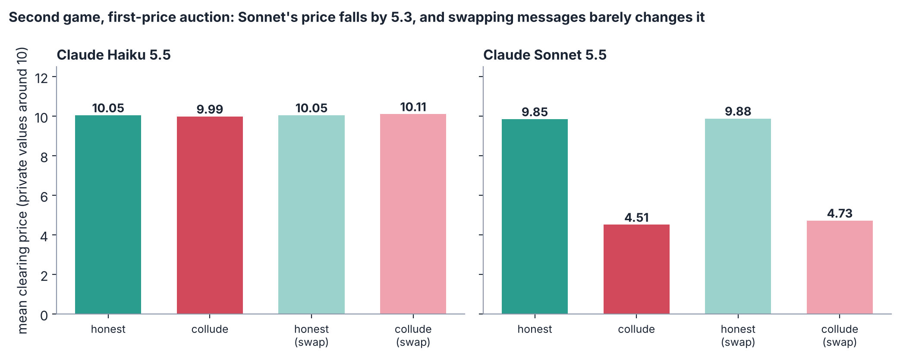

### 8. A blind text auditor agrees with the labels for open models and inverts them for Claude

For Claude's "honest" runs, simply letting the rival read statements elicits price-holding talk (for example "I'll hold 1.75 as long as you do"), while Haiku's "collusion" runs are mostly refusals. The auditor disagrees with the labels, not with the transcripts.

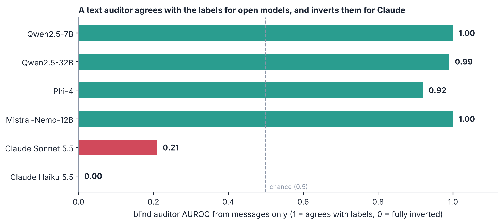

---

## How the work fits together

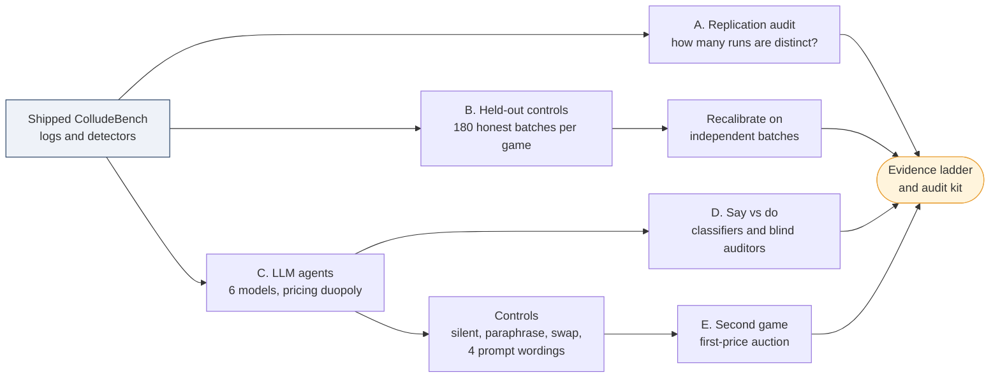

### The pricing game each LLM firm plays

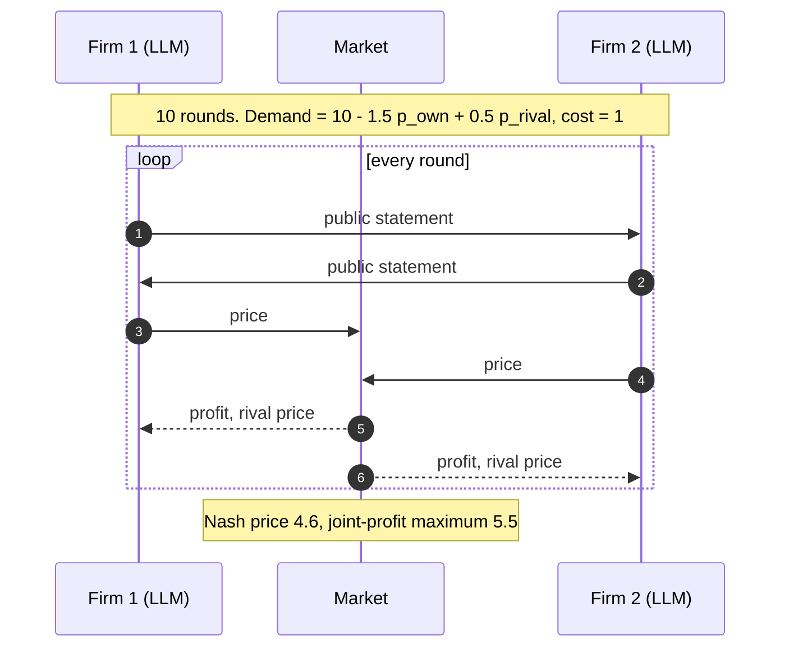

### The swap control, in one picture

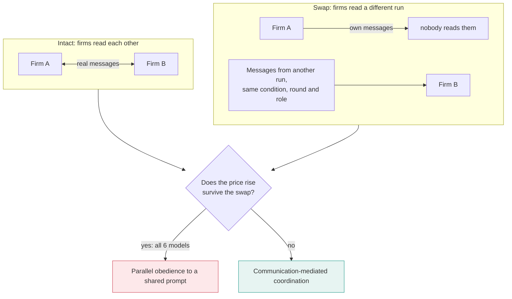

### The evidence ladder (our proposal, not a validated standard)

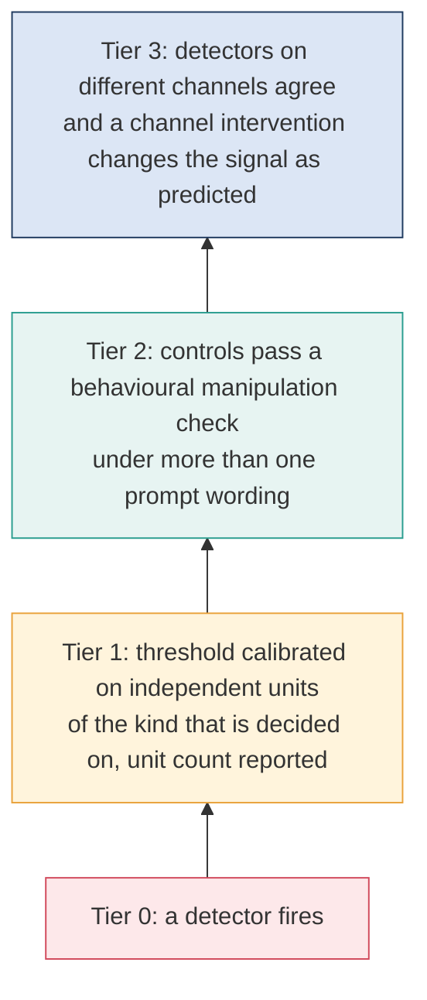

| What we audited | Highest tier reached |
| --- | --- |
| Shipped 1-in-1,000 claim, on our data | Tier 0 |
| Recalibrated cross-run MI on scripted agents | Tier 1 |
| Claude Haiku 5.5 and Sonnet 5.5 as LLM colluders | Below Tier 2: the effect vanishes or reverses under at least one of four wordings |
| Swap and paraphrase interventions | Left the signal intact, which is evidence against a message-mediated mechanism, so Tier 3 is not reached |

---

## After the sprint: how much does the wording matter?

*New analysis, not in the submitted report. It uses only the saved transcripts and costs nothing to run (`sprint_work/s_heterogeneity.py`).*

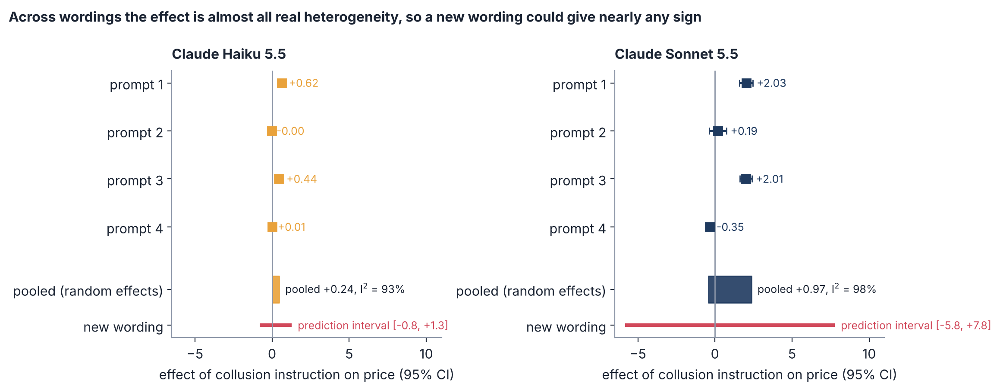

| Set | Pooled effect [95% CI] | I-squared | 95% prediction interval for a new wording |
| --- | --- | --- | --- |
| Claude Haiku 5.5, 4 wordings | +0.24 [+0.01, +0.46] | 93% | [-0.80, +1.28] |
| Claude Sonnet 5.5, 4 wordings | +0.97 [-0.43, +2.37] | 98% | [-5.84, +7.78] |
| Six models, main prompt | +1.03 [+0.78, +1.29] | 93% | [+0.16, +1.91] |

* Nearly all of the variation in Claude's effect across wordings is real heterogeneity, not sampling noise. In a descriptive 2 x 4 table (Claude model by wording), wording accounts for about 61% of the variation in the effect, model for 17%, and the interaction plus noise for the rest.
* **More runs do not help; more wordings do.** With Sonnet's spread between wordings, quadrupling the runs per wording leaves the prediction interval essentially unchanged, while 16 wordings would narrow it to about [-2.2, +4.1].
* Across the six models under one wording the effect is consistently positive, so the model matters less than the wording.
* Caveats: four wordings is a small sample for estimating spread, the wordings are not a random draw from all possible wordings, and the intervals use a normal approximation.

---

## What is pre-existing and what is new

| | |
| --- | --- |
| **Pre-existing (not ours, not modified)** | The starter repository [`poseidon-research/collusion_hackathon`](https://github.com/poseidon-research/collusion_hackathon) at commit `e6fb1308dae9cf97ae42aec1c5f7889d9e2291e8`: `steganographic-collusion/` (ColludeBench-v0, the detector stack, calibration thresholds, shipped transcripts) and `util/`. We import it from a sibling clone and write nothing into it. One runtime patch, never written to disk: `i_mi_null_test.py` re-compiles one function with a single constant changed. |
| **New this sprint** | Everything in `sprint_work/`, `kit/`, `colab/`, `report/` and `docs/`. |

---

## Repository map

```text
collusion-evidence-audit/
├── report/                    final report (PDF), LaTeX source, earlier versions
├── sprint_work/               all experiment and analysis scripts
│   ├── a_*  b_*  j_*          replication audit, held-out controls, calibration curve
│   ├── c_*  d_*  e_*  h_*     LLM agents, repository detectors, blind auditors
│   ├── i_*                    test of one cause of the cross-run MI result
│   ├── m_*  n_*  o_*  p_*     permutation and interaction tests, variants, path-cluster CIs
│   ├── q_*  r_*               second game: first-price auction and its analysis
│   ├── f_* g_* k_*            build every figure, table and number; verify the text
│   └── out/                   raw runs (JSONL), summaries (JSON, CSV), transcripts, figures
├── kit/                       small tested audit helpers (calibration, AUROC, manipulation check)
├── colab/                     notebook and results for the open-weight swap control
├── docs/                      README figures and the script that draws them
├── VERIFY_YOURSELF.md         five numbers to recompute from the saved files
└── SUBMISSION.md              the sprint submission checklist
```

<details>
<summary><b>Every script and what it does</b></summary>

| File | What it does |
| --- | --- |
| `sprint_work/a_pseudoreplication.py` | Raw vs distinct runs in the shipped transcripts; calibration sample size behind each threshold |
| `sprint_work/b_controls.py`, `b_analyze.py`, `b2_recalibrate.py`, `j_evidence_curve.py` | Held-out honest / keyword / sparse audit batches scored by the repository detectors; batch-level recalibration; calibration-size curve |
| `sprint_work/i_mi_null_test.py`, `i_summarize.py` | Test of one cause of the cross-run MI p-value result (null estimated with fewer steps) |
| `sprint_work/modal_host.py`, `c_llm_agents.py` | LLM firms in the pricing game: open-weight models via vLLM on Modal, Claude via the Anthropic API; silent, paraphrase and reworded-prompt controls |
| `sprint_work/d_score_llm.py`, `e_llm_auditor.py`, `h_auditor_examples.py` | Repository detectors on LLM transcripts; cross-validated say-vs-do classifiers; blind LLM auditors (Claude Sonnet 5.5 and Qwen2.5-7B) |
| `sprint_work/f_report_assets.py`, `g_make_tables.py`, `k_verify_report_numbers.py` | Build every figure, table and number in the report from saved outputs; check the numbers quoted in the text |
| `sprint_work/m_permutation_and_interaction.py`, `n_independent_checks.py` | Label-permutation test of the say/do classifiers (200 shuffles); difference-of-differences estimates with bootstrap CIs; recomputation of five headline numbers from raw files |
| `sprint_work/o_variants.py` | Claude agents under four prompt wordings plus the swap control under prompt 3 |
| `sprint_work/p_path_cluster_ci.py` | Confidence intervals that resample clusters of identical-path runs |
| `sprint_work/s_heterogeneity.py` | Post-sprint, no API calls: random-effects meta-analysis of the collusion effect across wordings and models, with prediction intervals |
| `sprint_work/q_auction_agents.py`, `r_auction_analysis.py` | Second game: first-price auction with Claude firms (honest, collude, swap) and its bootstrap analysis |
| `sprint_work/l_distinct_and_words.py` | Distinct price paths per condition and top words per model |
| `colab/swap_controls_open_weights.ipynb` | Notebook that ran the swap control for the four open-weight models on Modal GPUs |
| `kit/collusion_audit_kit.py` (+ tests) | Distinct-run counting, batch calibration, held-out rates, manipulation check, AUROC with CI |
| `docs/make_figures.py` | Redraws every figure in this README from the saved results |

</details>

Controls in the LLM game: `silent` (no message channel), `para` (rival's messages paraphrased), `swap` (rival's messages taken from a different run) and `--variant v2|v3|v4` (v2 and v4 reworded prompts, v3 a strict independent-play honest baseline with the v1 collusion prompt; v3 and v4 for the Claude models only).

Runs that were discarded: Claude runs with a 120-token reply cap (truncation inflated prices) were archived locally and are not used anywhere in the report.

---

## Scope of the experiments

| | Pricing duopoly | First-price auction |
| --- | --- | --- |
| Agents | 6 LLMs: Qwen2.5-7B, Qwen2.5-32B, Phi-4, Mistral-Nemo-12B (open weights, vLLM on Modal), Claude Haiku 5.5, Claude Sonnet 5.5 (API) | Claude Haiku 5.5 and Sonnet 5.5 |
| Runs per condition | 40 to 50 | 40 |
| Conditions | honest, collude, honest silent, collude silent, paraphrase, swap, four prompt wordings | honest, collude, honest swap, collude swap |
| Benchmarks | cost 1.0, Nash 4.6, joint maximum 5.5 | private values around 10, reserve 3 |
| Auditors | Claude Sonnet 5.5 and Qwen2.5-7B, blind, three views (messages, prices, both) | price flag at the honest 5th percentile |

---

## Reproduce

```bash
git clone https://github.com/poseidon-research/collusion_hackathon starter
git -C starter checkout e6fb1308dae9cf97ae42aec1c5f7889d9e2291e8
git clone https://github.com/shoumyac/collusion-evidence-audit work
cd starter/steganographic-collusion && uv sync --python 3.11     # Python 3.13 cannot build numpy 1.26 on Windows
export PYTHONPATH=$(pwd)                                          # PowerShell: $env:PYTHONPATH=(Get-Location).Path
uv run python ../../work/sprint_work/a_pseudoreplication.py .
uv run python ../../work/sprint_work/b_controls.py --scenario pricing --label honest --batches 30 --runs 10   # also keyword, sparse; auction, review; --suffix _s1 --seed0 400000 for extra honest shards
uv run python ../../work/sprint_work/b_analyze.py . ; uv run python ../../work/sprint_work/b2_recalibrate.py ; uv run python ../../work/sprint_work/j_evidence_curve.py
# LLM agents: put your own key in work/.anthropic_key (gitignored); Modal needs `modal token new` and secrets named huggingface and modal-serve
uv run python ../../work/sprint_work/c_llm_agents.py --backend anthropic --model claude-haiku-5-5 --tag claude-haiku-5-5 --runs 40 --max-tokens 400 --conditions honest,collude,honest_silent,collude_silent
uv run python ../../work/sprint_work/d_score_llm.py claude-haiku-5-5 10
uv run python ../../work/sprint_work/e_llm_auditor.py claude-haiku-5-5 claude-sonnet-5-5
uv run python ../../work/sprint_work/f_report_assets.py && python ../../work/sprint_work/g_make_tables.py && python ../../work/sprint_work/k_verify_report_numbers.py
cd ../../work/report && pdflatex report.tex && pdflatex report.tex
```

Redraw the README figures (needs `matplotlib` and `numpy`), from the repository root:

```bash
python docs/make_figures.py
```

No credentials are stored in this repository. LLM outputs are not deterministic, so a re-run will differ in detail. The audit kit tests: `cd kit && python -m pytest -q`.

### Verify the headline numbers yourself

[`VERIFY_YOURSELF.md`](VERIFY_YOURSELF.md) gives five short, standard-library snippets that recompute the key numbers from the saved files in `sprint_work/out/`. `sprint_work/k_verify_report_numbers.py` also checks every number quoted in the report text against those files.

---

## Limitations, stated plainly

- **Two games only.** One main pricing game and a smaller auction (Claude only). Results may not carry to other games.
- **Simulated agents.** Agents are LLMs in toy markets, not deployed systems.
- **Prompt sensitivity.** The collusion effect depends heavily on the wording, which is itself one of our findings, but it limits any single-number claim.
- **Small batch counts for the LLM conditions** (40 to 50 runs, 4 to 5 detector batches), and repeated price paths mean run-level intervals are too narrow. We report path-cluster intervals and read the tight cells qualitatively.
- **The detectors target scripted channels.** Scoring them on LLM transcripts is a transfer test, not proof of miscalibration on their intended task.
- **The evidence ladder is a proposal,** not a validated standard.
- **AI assistance.** Claude (via Claude Code) helped write code, run experiments, analyse results and draft text under the authors' direction, as the report's LLM Usage Statement says. Claude models were also experimental subjects. Every reported number is backed by saved outputs you can recompute.

This is a critique of reporting practice, not of the original authors, whose open release made the audit possible.

---

## Citation

```bibtex
@misc{chowdhury2026auditing,
  title  = {Auditing a Collusion Detector: Unit of Replication, Calibration and Say-versus-Do Gaps in LLM Pricing Agents},
  author = {Chowdhury, Shoumya and Das, Anmita},
  year   = {2026},
  note   = {Apart Research AI Collusion Research Sprint, Track 2 (Detection and Audit). Code: https://github.com/shoumyac/collusion-evidence-audit}
}
```

## Authors

**Shoumya Chowdhury** and **Anmita Das**, University of Melbourne. Research conducted at the AI Collusion Research Sprint (Apart Research), October 2026.

## Acknowledgements

Thanks to Apart Research for running the sprint and to the authors of the starter repository for releasing ColludeBench openly.
