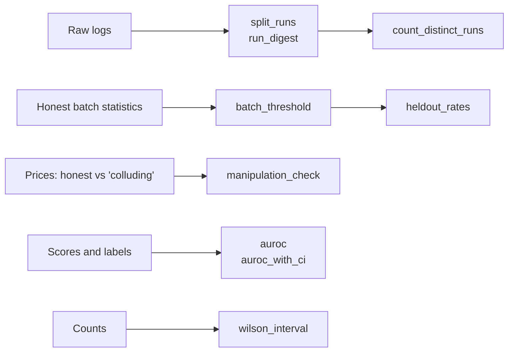

# Audit Kit

A small, dependency-light Python module for the checks that mattered in this audit. It lives in `kit/collusion_audit_kit.py`, with tests in `kit/test_collusion_audit_kit.py`.



## What is in it

| Function | Use it to |
| --- | --- |
| `split_runs` | Split a transcript file where `round_id` drops into separate runs |
| `run_digest` | Hash a run, optionally ignoring the run id |
| `count_distinct_runs` | Count raw and distinct runs over a set of files |
| `wilson_interval` | Wilson 95% interval for a proportion |
| `batch_threshold` | Set a threshold at the empirical 1 - alpha quantile of independent honest batches, and refuse (ValueError) when there are too few batches to support that alpha |
| `heldout_rates` | Random half splits of the honest batches: returns the held-out false-positive rate (`heldout_fpr`) and the detection rate (`tpr`) |
| `manipulation_check` | Mean price difference with a bootstrap CI, where the colluding mean sits between Nash and the joint maximum, and whether the label is supported (CI above zero) |
| `auroc`, `auroc_with_ci` | AUROC, with a bootstrap interval |

## Example: do I have enough independent honest batches?

```python
from kit.collusion_audit_kit import heldout_rates

honest = [...]       # one statistic per independent honest batch
colluding = [...]    # one statistic per colluding batch
print(heldout_rates(honest, colluding, alpha=0.05, splits=500, seed=0))
```

## Run the tests

```bash
cd kit && python -m pytest -q
```

## Scope

The kit is a convenience for this project, not a validated library. Read the code before you rely on it.
