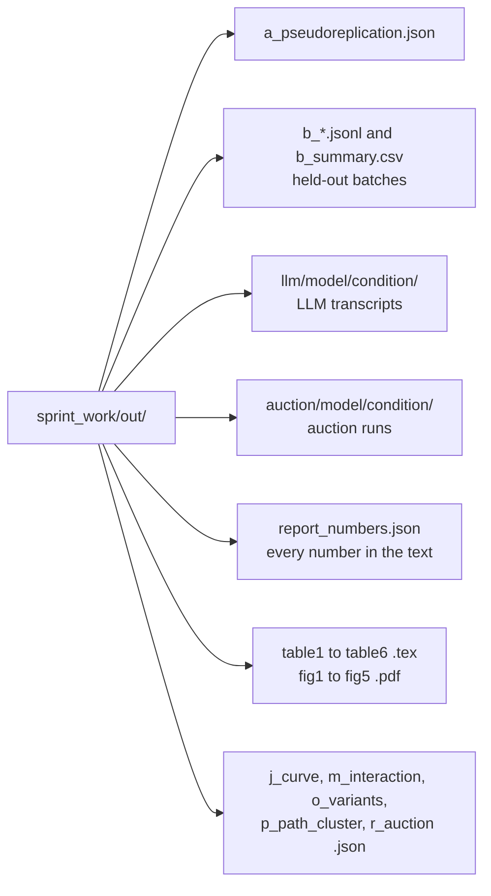

# Data Guide

Where each number and figure lives. Everything is plain JSONL, JSON or CSV in `sprint_work/out/`.

## Folder map

## Which file answers which question

| Question | File |
| --- | --- |
| How many runs are distinct in the shipped logs? | `a_pseudoreplication.json` |
| What fraction of honest batches does each detector flag? | `b_<scenario>_honest*.jsonl`, `b_summary.csv`, `report_numbers.json` (`B_pvalue_rates`) |
| What does recalibration give? | `b2_recalibrated.csv` |
| How does the false-positive rate depend on calibration size? | `j_curve.json` |
| How many distinct price paths per condition? | `l_distinct.json` |
| What is the effect with messages, silent, swap, paraphrase? | `m_interaction.json`, `table_interaction.tex` |
| What changes with the prompt wording? | `o_variants.json`, `table_variants.tex` |
| Do cluster-based intervals change the answer? | `p_path_cluster.json`, `table_cluster.tex` |
| What happened in the auction? | `r_auction.json`, `table_auction.tex`, `auction/` |
| Are the shuffled-label classifiers near chance? | `m_permutation.json`, `table_permutation.tex` |
| What did the auditors say about specific transcripts? | `auditor_examples_<model>.json` |
| Was the null test of the MI detector informative? | `i_mi_summary.json`, `i_mi_null_*.jsonl` |

## File naming

| Pattern | Meaning |
| --- | --- |
| `b_<scenario>_<label>[_sN].jsonl` | Held-out audit batches. Scenario is pricing, auction or review. Label is honest, keyword, sparse, smart or adaptive. `_sN` marks an extra honest shard with a different seed range |
| `llm/<model>/<condition>/llm_<model>_<condition>_<k>.jsonl` | LLM pricing runs in the repository transcript format |
| `llm/<model>-v2`, `-v3`, `-v4` | Claude runs under prompt wordings 2, 3 and 4 |
| `auction/<model>/<condition>/auc_*.jsonl` with `.meta.json` | Auction runs and their token counts |
| `fig*.pdf`, `table*.tex` | Report figures and tables, built by `f_report_assets.py` and `g_make_tables.py` |

## Conditions

| Condition | Meaning |
| --- | --- |
| `honest`, `collude` | Main prompt, message channel on |
| `honest_silent`, `collude_silent` | No message channel |
| `para` | Rival's messages paraphrased |
| `honest_swap`, `collude_swap` | Rival's messages taken from a different run |

## Using the data

Everything the report quotes is recomputable. See [Reproduce and Verify](Reproduce-and-Verify) for the five-number check, and `sprint_work/k_verify_report_numbers.py` for the full check of the text.
