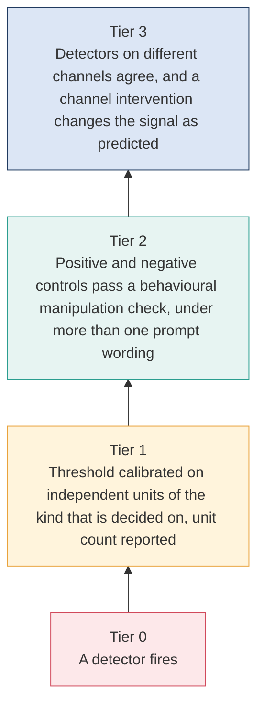

# Evidence Ladder

A proposal for how an audit report should state how strong its evidence is. It is a **proposal, not a validated standard.**

## What each tier asks for

| Tier | Requirement | Why it matters |
| --- | --- | --- |
| **0** | A detector fires | A bare alarm, with no known error rate |
| **1** | The p-value or threshold is calibrated on independent units of the same kind as the decision unit, and the unit count is reported | Stops pseudoreplication: about 20 honest units were needed in our data |
| **2** | The outcome moves in the predicted direction with a CI excluding zero under more than one prompt wording, what the agents say does not contradict the label, and a false-positive check on honest agents of the same model family passes | Stops "the label is the evidence" |
| **3** | Detectors on different channels (messages and actions) agree, and a channel intervention (paraphrase, or swapping in another run's messages) changes the signal as the hypothesis predicts | Separates communication from parallel obedience |

## Where our evidence lands

| Object audited | Tier | Reason |
| --- | --- | --- |
| Shipped 1-in-1,000 claim, on our data | 0 | Flags 99 to 100% of fresh honest batches |
| Recalibrated cross-run MI on scripted agents | 1 | About 5 to 6% held-out false positives, 100% detection |
| Claude Haiku 5.5 as an LLM colluder | below 2 | Effect is +0.62, 0.00, +0.44, +0.01 across wordings, and most collusion-condition messages refuse under prompts 1 and 3 |
| Claude Sonnet 5.5 as an LLM colluder | below 2 | Effect is +2.03, +0.19, +2.01, -0.35 across wordings |
| Swap and paraphrase interventions | not Tier 3 | Both left the signal intact, which is evidence against a message-mediated mechanism rather than a confirmation of one |

## Practical checklist for an audit report

1. State the number of independent units behind each threshold.
2. Calibrate on the decision unit, not on a larger unit that contains copies.
3. Check a positive control's behaviour, not only its prompt.
4. Use detectors on separate channels.
5. Validate honest baselines on the model family under audit.
6. Say which tier the report reaches.
