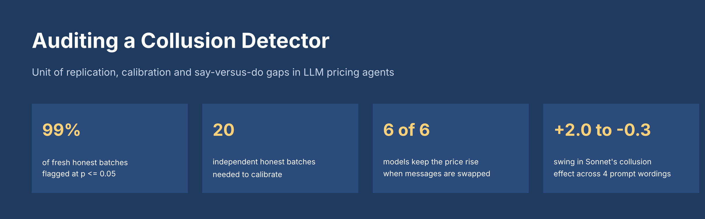
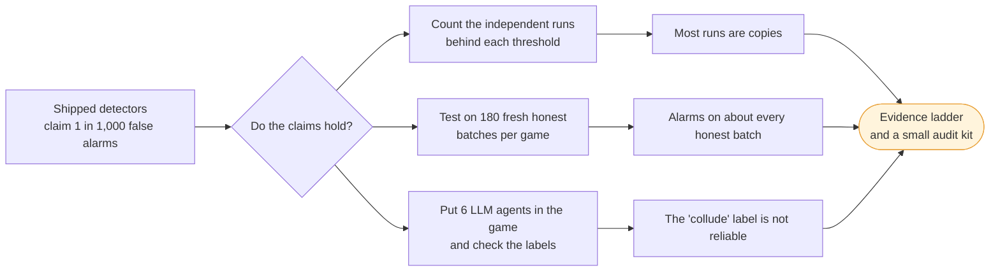

# Welcome

This wiki explains the project **Auditing a Collusion Detector** in plain steps, with pictures first and text second. It was built for the **Apart Research AI Collusion Research Sprint (October 2026), Track 2: Detection and Audit**, by Shoumya Chowdhury and Anmita Das (University of Melbourne). The project placed in the top 25% of more than 390 submissions.

> **The question.** When a collusion detector says "collusion", what evidence stands behind it, do its error rates hold on fresh data, and do the labels of its test cases match what the agents actually do?

## Start here

| If you want to... | Go to |
| --- | --- |
| See the results in two minutes | [Key Findings](Key-Findings) |
| Understand the games the agents play | [The Games](The-Games) |
| Understand how we tested the detector | [Methods](Methods) |
| See the evidence ladder we propose | [Evidence Ladder](Evidence-Ladder) |
| Find a file or a number | [Data Guide](Data-Guide) |
| Re-run or check the work | [Reproduce and Verify](Reproduce-and-Verify) |
| Use the small helper library | [Audit Kit](Audit-Kit) |
| Get plain answers to common questions | [FAQ](FAQ) |
| See what is weak and what comes next | [Limitations and Roadmap](Limitations-and-Roadmap) |

## The project in one picture

## Links

* [Report (PDF)](https://github.com/shoumyac/collusion-evidence-audit/blob/main/report/report.pdf)
* [Repository README](https://github.com/shoumyac/collusion-evidence-audit#readme)
* [Starter repository we audited](https://github.com/poseidon-research/collusion_hackathon) (commit `e6fb1308`)
