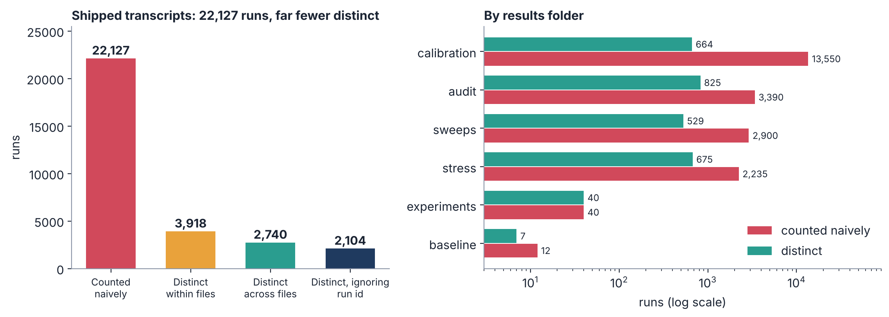
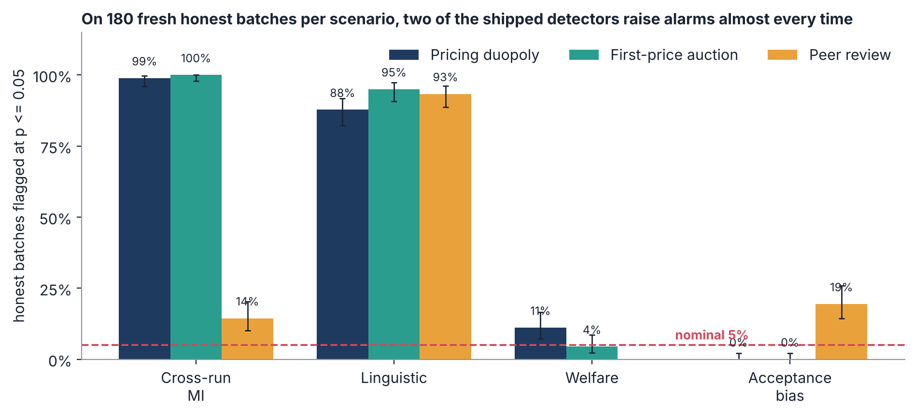
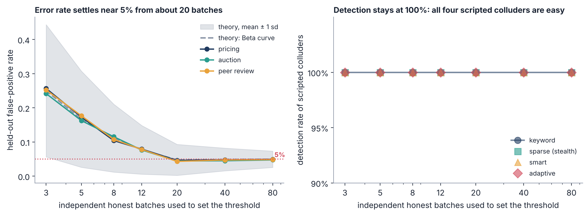
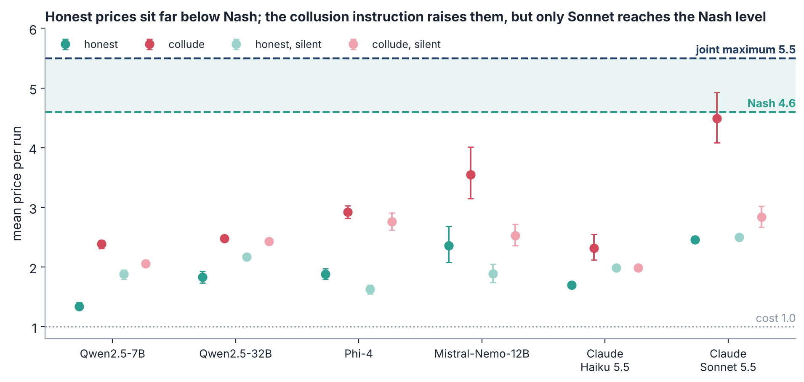
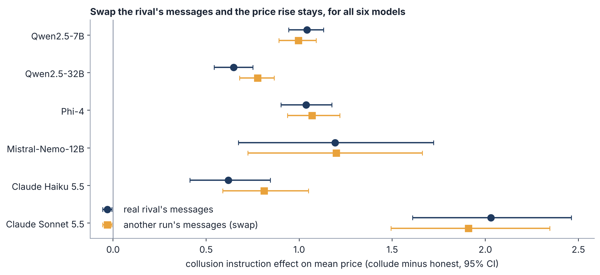
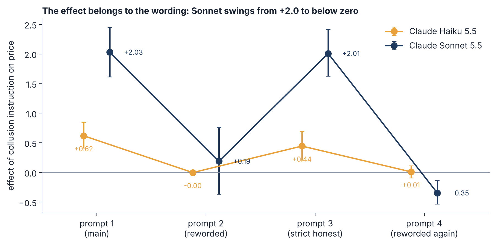
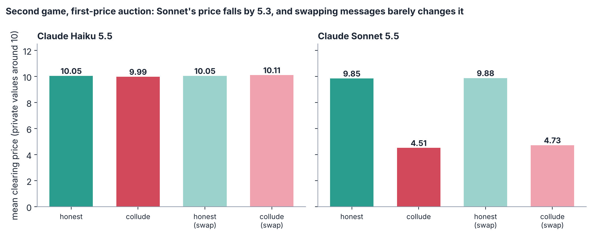
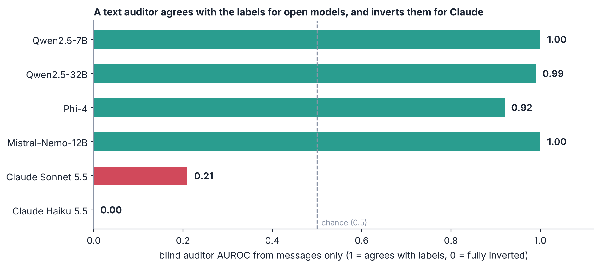

# Key Findings

Eight results, each with the picture that supports it. All numbers come from saved files in `sprint_work/out/`.

## Scoreboard

| # | Finding | Number |
| --- | --- | --- |
| 1 | Runs counted by the shipped logs vs runs that are distinct | 22,127 vs 3,918 (within files) vs 2,740 (across files) |
| 2 | Fresh honest batches flagged by the shipped cross-run MI p-value at 0.05 | 99% in pricing, 100% in the auction |
| 3 | Independent honest batches needed to recalibrate to about 5% held-out false positives | about 20 |
| 4 | Independent units needed to support a 1-in-1,000 claim | about 3,000 |
| 5 | Models where the price rise survives swapping the rival's messages | 6 of 6 |
| 6 | Sonnet's collusion effect across four prompt wordings | +2.03, +0.19, +2.01, -0.35 |
| 7 | Sonnet's clearing price in the auction, honest vs collude | 9.85 vs 4.51 |
| 8 | Blind auditor AUROC from messages only, Haiku and Sonnet | 0.00 and 0.21 |

## 1. Most logged runs are copies

A threshold at the 1-in-1,000 level needs at least 1,000 independent samples. Seven of the eight shipped thresholds equal the maximum of their calibration sample, and the eighth (cross-run MI) uses pairs drawn from at most 200 runs per scenario.

## 2. On fresh honest data the p-values are far from nominal

The linguistic detector fails for a reason visible in its code: it compares the maximum of a sample's chi-square values with that same sample's own mean and standard deviation. The MI detector estimates its shuffled null with fewer optimisation steps than its statistic, which is one real contributor but not the whole story (Appendix of the report).

## 3. The statistics work; the thresholds need independent calibration

Left: with 3 honest batches the held-out error of a 5% threshold is about 25%; from about 20 batches it is 4 to 5%. The empirical curve follows the exact theory for a threshold at an order statistic. Right: recalibrated cross-run MI detects all four scripted colluders every time, which shows it can find those scripted channels. It says nothing about unknown ones.

## 4. LLM firms price below the Nash level

Honest LLM prices sit near cost. The collusion instruction raises the mean price for every model, but only Claude Sonnet 5.5 reaches the Nash level (4.49, CI 4.08 to 4.93), and no model's mean reaches the joint maximum. A higher price than the honest run is therefore not by itself supracompetitive.

## 5. The swap control

For all six models the interval of the intact-minus-swapped difference contains zero. The rise does not depend on reading the rival.

## 6. Prompt wording decides the effect

Under prompt 4 the collusion-labelled Sonnet runs price below the honest-labelled ones. Prompt 3 is the cleanest control: the honest firm is told to compete independently, the blind auditor then agrees with the labels (AUROC 1.00), and the price rise is still not mediated by reading the rival.

## 7. A second game repeats the swap result

Sonnet's price falls by 5.34 [5.13, 5.55]. Intact minus swapped is -0.21 [-0.42, +0.01], about 4% of the effect. A price flag at the honest 5th percentile marks 100% of intact and swapped Sonnet collusion runs, so an outcome detector cannot tell communication from parallel obedience.

## 8. A text auditor sees what the labels hide

In Haiku's collusion condition, 98% of messages decline to coordinate. In its honest condition, 63% match a price-stability pattern. The auditor disagrees with the labels, not with the transcripts.
