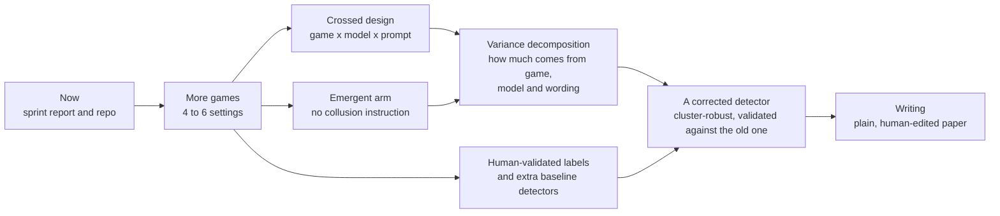

# Limitations and Roadmap

## Limitations

| Area | Limitation | Effect on claims |
| --- | --- | --- |
| Breadth | One main pricing game and a smaller auction (Claude only) | Results may not carry to other games |
| Realism | LLM agents in toy markets, not deployed systems | We make no claim about real markets |
| Prompt sensitivity | The effect depends heavily on the wording | A single-number claim about a model is not supported |
| Sample size | 40 to 50 runs per LLM condition, 4 to 5 detector batches | Wide uncertainty, especially for detector rates |
| Replicates | Many runs repeat the same price path | Run-level intervals are too narrow, so we add path-cluster intervals and read tight cells qualitatively |
| Detector scope | Detectors target scripted channels, and LLM transcripts are a transfer test | We do not claim miscalibration on their intended task from the LLM results |
| Ladder | The evidence ladder is a proposal | Not a validated standard |
| Unexplained | The shipped union validation reports a Westfall-Young FPR of 1.0 at both nominal levels | We did not investigate why |

## What the reviewers asked for

The sprint feedback pointed to the same gaps from different angles: readability of the report, the amount of AI involvement, and the critique-heavy framing. The roadmap below is built around fixing those.

## Roadmap (planned, not committed)

| Step | What it adds |
| --- | --- |
| More games | Tests whether the swap and prompt-wording results are general |
| Crossed design | Separates game, model and wording effects with a mixed-effects model |
| Corrected detector | A positive contribution beyond the audit: cluster-robust inference with a design-effect correction |
| Emergent arm | Looks for coordination with no instruction to coordinate |
| Human validation and baselines | Checks the auditors and adds comparison detectors |
| Rewrite | A plain, carefully human-edited paper |

Compute is the main constraint. Claude runs use API credit; open-weight runs need rented or institutional GPUs.

## Contributing and feedback

Issues and suggestions are welcome, especially: a game you would like tested, a detector you would like audited, or a mistake you spot in a number. Open an issue on the repository.
