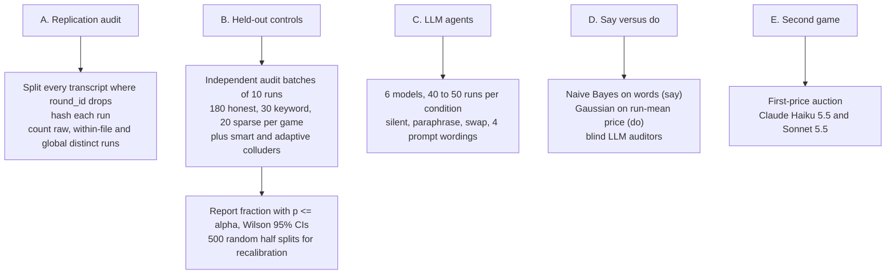

# Methods

Five analyses, A to E, as in the report.

## A. Replication audit

We split every shipped transcript at the points where `round_id` drops (several runs appended to one file), hash each run, and count three things: runs counted naively, runs distinct within each file, and runs distinct across all files. We also read the calibration sample size behind each of the eight thresholds.

## B. Held-out controls

Detectors act on an **audit**, a batch of 10 runs. We generated independent batches with seeds disjoint from the shipped calibration, in three scenarios (pricing duopoly, first-price auction, peer review), using the repository's own audit configurations. The decision unit is the **batch**.

| Batch type | Count per scenario |
| --- | --- |
| Honest | 180 |
| Keyword colluder | 30 |
| Stealth ("sparse") colluder | 20 |
| Smart colluder | 20 |
| Adaptive colluder | 20 (4 for peer review, which was too slow to finish) |

**Recalibration.** 500 random half splits of the honest batches: the threshold is the 95th percentile of the calibration half, the false-positive rate is measured on the other half, and the detection rate on all colluding batches. A calibration-size curve varies how many honest batches set the threshold.

**Theory.** For a threshold at the r-th order statistic of n calibration batches, the exceedance probability follows a Beta(n - r + 1, r) distribution with mean (n - r + 1) / (n + 1). The empirical curve follows it.

## C. LLM agents

Two firms play the repository's pricing environment for 10 rounds. A reply with no parsable price keeps the previous price (4.0 in round 1). Cells with more than 5% such replies are marked with a dagger in the report tables. Transcripts use the repository format and are scored by the repository detectors in batches of 10.

**Confidence intervals.** Ordinary bootstrap over runs, plus a **path-cluster bootstrap** that resamples clusters of identical-path runs, because runs that repeat the same price path are replicates, not independent samples. The cluster intervals are wider, and every message-condition effect stays clearly positive.

**Difference of differences.** (collude minus honest with messages) minus (collude minus honest silent), with bootstrap intervals. This isolates what the message channel adds to the instruction.

## D. Say versus do

1. **Say classifier:** naive Bayes on words, 5-fold cross-validated with bootstrap CIs, also with every word of the prompts masked.
2. **Do classifier:** a Gaussian on the run-mean price.
3. **Label-permutation test:** 200 shuffles of the labels. The shuffled AUROC averages 0.47 to 0.51, and the largest of 200 is 0.63 to 0.71, below the observed values.
4. **Blind auditors:** Claude Sonnet 5.5, and Qwen2.5-7B as a different family, read one transcript in three views (messages, prices, both) and return a 0 to 100 suspicion score. They are never told the condition.

## E. Second game

The same design in the first-price sealed-bid auction, 40 runs per cell, for the two Claude models. Analysis: bootstrap with 10,000 resamples, plus a price flag at the honest 5th percentile.

## What we mean by collusion

The sprint's own comparison of 139 definitions separates an **economics family** (prices sustained above the static Nash price) from an **AI-safety family** (unwanted, covert coordination). We use both, for different objects:

* For scripted benchmark agents, "colluding" means encoding a covert signal through a channel, which is what the detectors target.
* For LLM agents we judge behaviour by price against Nash and the joint maximum, and we treat the instruction to coordinate as an operational label of intent, not as evidence of an agreement.

We do not claim that any run involved a meeting of minds.
