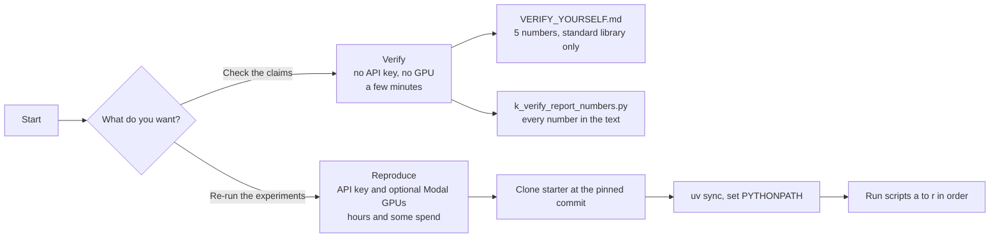

# Reproduce and Verify

Two different jobs: **verify** (cheap, recompute numbers from saved files) and **reproduce** (expensive, re-run experiments).



## Verify (no cost)

1. Clone this repository.
2. Open [`VERIFY_YOURSELF.md`](https://github.com/shoumyac/collusion-evidence-audit/blob/main/VERIFY_YOURSELF.md) and run the five snippets. Each recomputes one headline number from the saved files:
   * honest batches flagged by cross-run MI (0.99 of 180)
   * distinct runs in the shipped logs (22,127 vs 3,918)
   * Haiku collusion vs honest mean price (2.32 vs 1.70)
   * Haiku silent prices and distinct paths (1.99 vs 1.99; 3 and 4 of 40)
   * blind-auditor AUROC for Haiku (0.00)
3. Read two transcripts end to end. Numbers tell you what happened; transcripts tell you why.
4. Run `python sprint_work/k_verify_report_numbers.py` to check every number quoted in the report text.

## Reproduce (costs money and time)

```bash
git clone https://github.com/poseidon-research/collusion_hackathon starter
git -C starter checkout e6fb1308dae9cf97ae42aec1c5f7889d9e2291e8
git clone https://github.com/shoumyac/collusion-evidence-audit work
cd starter/steganographic-collusion && uv sync --python 3.11
export PYTHONPATH=$(pwd)
```

Then run the scripts in `work/sprint_work/` in order a, b, j, c, d, e, f, g, k. The full command list is in the [README](https://github.com/shoumyac/collusion-evidence-audit#reproduce).

### Things you must supply yourself

| Item | How |
| --- | --- |
| Anthropic API key | Save it in `work/.anthropic_key`. The file is gitignored |
| Modal account and token | `modal token new`, with secrets named `huggingface` and `modal-serve` |
| Python 3.11 | Python 3.13 cannot build numpy 1.26 on Windows |

### Rough cost scale

Costs are our own estimates from logged token counts, at the Anthropic prices we used in October and November 2026. Check current prices first.

| Run | Approx. tokens | Approx. cost |
| --- | --- | --- |
| One Claude pricing run | 17k in, 1.3k out | a few cents on Sonnet, well under a cent on Haiku |
| One Claude auction run | 39k in, 2.3k out | about $0.10 on Sonnet, about $0.005 on Haiku |

LLM outputs are not deterministic, so a re-run will differ in detail. The conclusions should hold, the third decimal will not.

## Safety notes

* Never commit keys. `.anthropic_key` and the Modal tokens stay local.
* Stop any running Modal app when you finish (`modal app list`).
