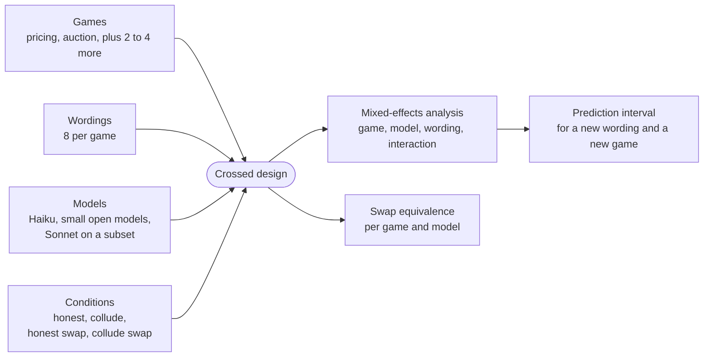

# Study Plan: A Larger Version on a Near-Zero Budget

*A plan, not a commitment. Costs come from our logged token counts at the Anthropic prices we used in October and November 2026. Check current prices before you spend anything.*

## The idea

The wording analysis ([Wording Heterogeneity](Wording-Heterogeneity)) shows that for Sonnet the effect of the collusion instruction varies so much across wordings that more runs of one wording change nothing, while more wordings do. So the next study should spend its budget on **breadth**: more games and more wordings, with modest runs per cell.

## Cost options

Per-run cost is about $0.005 for Haiku, $0.10 for Sonnet and $0.20 for Opus, using the auction-sized run (39k input and 2.3k output tokens) for every game. That is conservative for the shorter games. Estimates are good to roughly 30%.

| Block | Runs | Cost | With 25% buffer |
| --- | --- | --- | --- |
| A. Haiku, 6 games x 8 wordings x 4 conditions x 40 runs | 7,680 | $39 | $49 |
| E. Haiku "emergent" arm (no collusion instruction), 6 games x 8 wordings x 40 runs | 1,920 | $10 | $12 |
| B. Sonnet, 3 games x 6 wordings x 4 conditions x 20 runs | 1,440 | $145 | $182 |
| C. Sonnet, 3 games x 8 wordings x 4 conditions x 20 runs | 1,920 | $194 | $242 |
| D. Opus, 2 games x 4 wordings x 4 conditions x 15 runs | 480 | $97 | $121 |

Open-weight models (Qwen, Phi, Mistral) cost nothing in API fees if run on free or institutional GPUs. They need the same games and wordings.

**A free-ish path.** Blocks A and E (about $61 with buffer) fit inside one month of your plan credit (about $100, by your figure). Block B adds about $182, which fits across the following two months. Blocks C and D are the first to drop if credit runs short.

## Free compute for the open-model arm

| Option | Note |
| --- | --- |
| Spartan, through a supervisor | Free if access is granted. Needs a project with a research goal |
| Remaining Modal credit | About $95 by your earlier figure. Check the balance |
| Free Colab or Kaggle GPUs | 7B-class models with quantisation. Sessions disconnect, so the runner must save after every run |

## Phases

| Phase | Work | Needs money? |
| --- | --- | --- |
| 1. December | Read the three closest papers; write the runners for the new games and test them with a stub agent (no API); write the cost tracker | No |
| 2. January | Haiku grid (block A) on the first two new games; first open-model runs; check the pipeline end to end | About $25 |
| 3. February to March | Remaining games; emergent arm; Sonnet on a subset | About $100 to $200 |
| 4. April | Full analysis: mixed effects, prediction intervals, swap equivalence per cell; figures | No |
| 5. Before the deadline | Plain, hand-edited writing; internal read-through; submission | No |

The NeurIPS 2027 deadline is not confirmed. Past NeurIPS cycles have been due around May, but check the official call when it appears and shift the phases to fit.

## Decision gates

* **End of January:** if the Haiku grid shows no heterogeneity worth explaining, narrow the paper to the audit contribution and aim at a smaller venue.
* **End of March:** if there is no budget for Sonnet, run with Haiku and open models and say so plainly.
* **Always:** keep the verification script green after every change, and keep keys out of the repo.

## Risks

* Time while you settle back in Bangladesh in December, so phase 1 is deliberately light.
* Wordings are our own, not a random sample, so the prediction interval describes our wording family only.
* Other groups are working on the same topic (see [Related Work](Related-Work)), so speed and a clear contribution matter.
