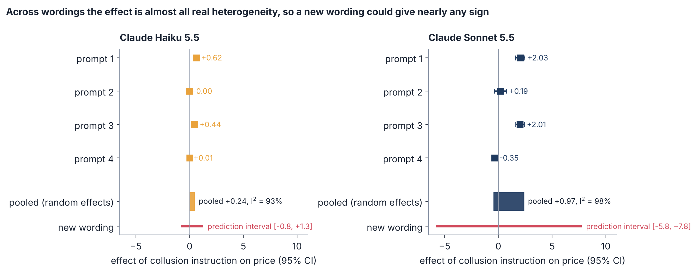

# Wording Heterogeneity

*Post-sprint analysis, not in the submitted report. Script: `sprint_work/s_heterogeneity.py`. Output: `sprint_work/out/s_heterogeneity.json` and `table_heterogeneity.tex`. No API calls.*

## The question

The sprint report showed that the collusion effect changes with the prompt wording. This analysis puts a number on how much, and asks what a new wording would give.

## Method

A DerSimonian-Laird random-effects meta-analysis treats each wording (or model) as one study, with its effect (collude minus honest mean price) and standard error from the run-level data. We report the between-wording spread (tau), I-squared (the share of variation that is real heterogeneity), and a 95% prediction interval for the effect under a new wording: pooled effect plus or minus t(k-2) times the square root of tau-squared plus the squared standard error of the pooled effect.

## Results

| Set | Pooled effect | tau | I-squared | Prediction interval |
| --- | --- | --- | --- | --- |
| Haiku, 4 wordings | +0.24 | 0.21 | 93% | [-0.80, +1.28] |
| Sonnet, 4 wordings | +0.97 | 1.41 | 98% | [-5.84, +7.78] |
| Six models, main prompt | +1.03 | 0.29 | 93% | [+0.16, +1.91] |

## What buys precision

Using Sonnet's spread between wordings, the prediction interval depends on the number of wordings, not on the runs per wording:

| Design | Approximate prediction interval |
| --- | --- |
| 4 wordings, current runs | [-5.8, +7.8] |
| 4 wordings, 4 times the runs | [-5.8, +7.8] |
| 8 wordings | [-2.7, +4.6] |
| 16 wordings | [-2.2, +4.1] |

This is the strongest argument for the planned crossed design: spend the budget on more wordings and games, not on more runs of the same wording.

## Caveats

* Four wordings are too few to estimate spread reliably, and the prediction interval has only 2 degrees of freedom.
* The wordings are ones we wrote, not a random sample.
* The two-way split of the effect (wording about 61%, model about 17%, interaction and noise about 23%) is descriptive, with one cell per combination.
* Runs that repeat the same price path may be independent draws from a low-variance process rather than copies, so the run-level standard errors here are not obviously too narrow. The wording spread is the larger source of uncertainty for any claim about a new prompt.
